<!-- Assets are generated by scripts/render.py. Edit the config there, not the SVGs. -->

  
  &nbsp;
  

  
  &nbsp;
  

 

 

 

  

 

  
  

  
  

 

<picture>
  <source media="(prefers-color-scheme: dark)" srcset="https://raw.githubusercontent.com/PrashantAHD/PrashantAHD/output/snake-dark.svg"/>
  <source media="(prefers-color-scheme: light)" srcset="https://raw.githubusercontent.com/PrashantAHD/PrashantAHD/output/snake-light.svg"/>
  
</picture>

 

  

